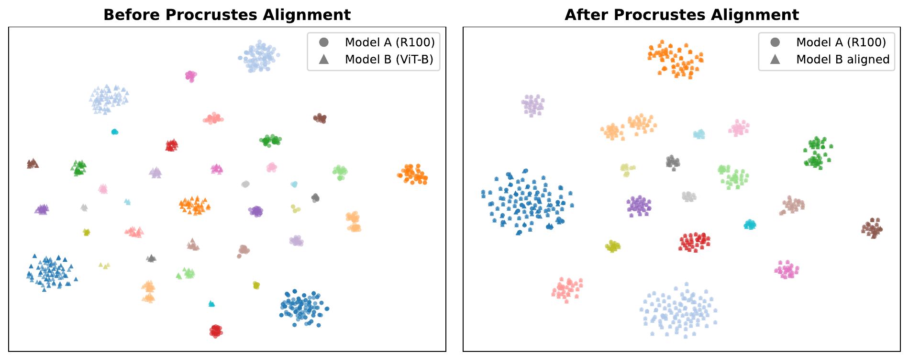
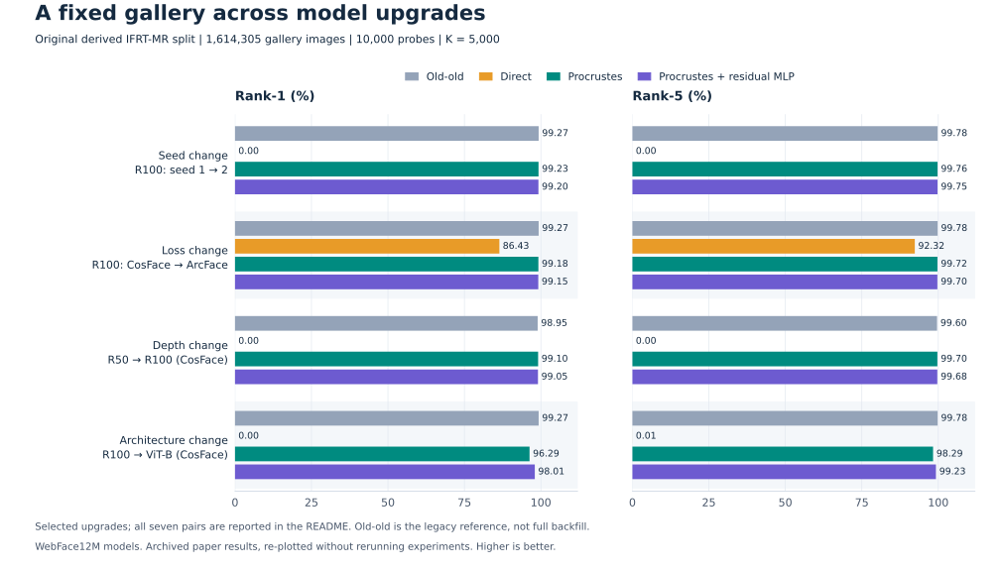
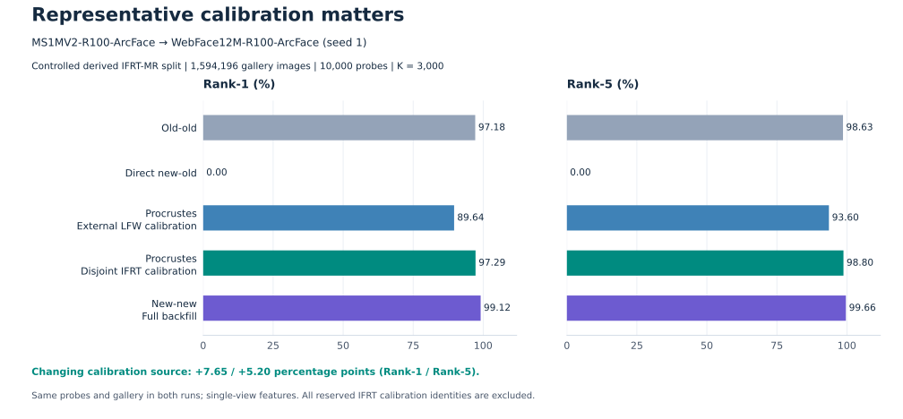
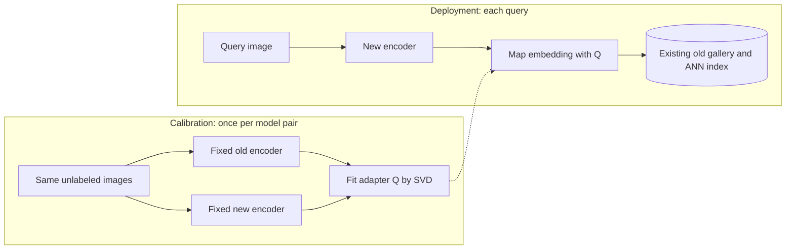

# ORBIT-Face

### Align the space. Keep the gallery.

**O**rthogonal **R**igidity for **B**ackfill-free **I**nter-model **T**ransport

Code companion to **Representation Rigidity in Face Embeddings: Orthogonal Identifiability and Backfill-Free Compatibility**.

**Yongle Zhao · Zhichao Chen · Yin Xie · Jun Wang · Ziyong Feng**  
**DeepGlint · NeurIPS 2026**

[Paper](https://openreview.net/forum?id=alci29b9Vd) · [Why ORBIT?](#why-orbit) · [Results](#experimental-highlights) · [How it works](#how-it-works) · [Minimal example](#minimal-example) · [Citation](#citation)

## Why ORBIT?

Different models take different paths during training. Yet their face embeddings can arrive at remarkably similar relational geometry, expressed in different coordinate systems.

Think of the embeddings as a constellation: the relationships between its points may remain nearly the same even when the whole constellation is rotated or reflected. **ORBIT-Face aligns the coordinate systems so the models can work together.** New queries enter the legacy space; the stored gallery stays where it is.

The name also has a geometric meaning. An orbit under orthogonal transformations is a family of representations related by rotations or reflections. Independently trained face models can lie near the same orbit when their relational geometry is sufficiently preserved. This is an approximate, model-dependent property—the paper studies both where it holds and where it breaks.

> **A new model. A familiar space. The same gallery.**

## Overview

Upgrading a face-recognition encoder usually changes its embedding coordinates. Comparing new query embeddings directly with old gallery embeddings can therefore fail, even when both models recognize faces well on their own. Recomputing the entire gallery—**backfilling**—can be expensive.

ORBIT-Face studies a different deployment path:

1. Run a representative set of calibration images through both fixed encoders.
2. Fit one global orthogonal adapter from the paired embeddings using SVD.
3. Map each new query embedding into the old coordinate system.
4. Search the existing gallery with its existing index.

The base adapter requires paired embeddings, but no identity labels, classifier weights, training-set access, or gallery embeddings for fitting. The pairing comes from encoding the **same images**, in the same order, with the two models.

The research contribution is the characterization of face-embedding rigidity, its connection to compatibility, and its operating boundaries. The adapter uses classical orthogonal Procrustes alignment.

## Experimental highlights

The figures below use existing paper artifacts. The quantitative charts and tables are generated from [archived aggregate metrics](assets/data/experiment_results.json); no experiments were rerun to produce them. [Source and protocol notes](assets/README.md) document the original artifacts and their reproducibility limits.

### Different coordinates, improved correspondence



**The orbit intuition in a picture.** Circles represent R100 embeddings, triangles represent ViT-B embeddings, and colors indicate identities. After alignment, the two models show improved visual correspondence. This is a qualitative t-SNE projection; it does not imply exact high-dimensional alignment or eliminate the cross-architecture retrieval gap.

### Keeping a million-scale gallery in place



**Protocol:** the paper's original derived IFRT-MR identification split, with **1,614,305 gallery images**, **10,000 probes**, and **K = 5,000** for both aligned methods. Models are trained on WebFace12M. Entries below are **Rank-1 / Rank-5 (%)**, with the upgrade direction shown as old → new.

<!-- BEGIN IFRT_TABLE -->

| Upgrade | Old-old | Direct | Procrustes | Procrustes + MLP |
|---|---:|---:|---:|---:|
| R100 (CosFace), seed 1 → 2 | 99.27 / 99.78 | 0.00 / 0.00 | 99.23 / 99.76 | 99.20 / 99.75 |
| ViT-B (CosFace), seed 1 → 2 | 98.94 / 99.67 | 0.00 / 0.00 | 98.95 / 99.59 | 98.90 / 99.61 |
| R100, CosFace → ArcFace | 99.27 / 99.78 | 86.43 / 92.32 | 99.18 / 99.72 | 99.15 / 99.70 |
| ViT-B, CosFace → ArcFace | 98.94 / 99.67 | 95.81 / 98.25 | 98.93 / 99.62 | 98.89 / 99.55 |
| R50 → R100 (CosFace) | 98.95 / 99.60 | 0.00 / 0.00 | 99.10 / 99.70 | 99.05 / 99.68 |
| R100 → ViT-B (CosFace) | 99.27 / 99.78 | 0.00 / 0.01 | 96.29 / 98.29 | 98.01 / 99.23 |
| R50 → ViT-B (CosFace) | 98.95 / 99.60 | 0.00 / 0.00 | 96.43 / 98.48 | 97.97 / 99.26 |

<!-- END IFRT_TABLE -->

Same-family alignment approaches the old-old reference, while CNN → ViT remains harder. A fitted residual MLP narrows that gap but does not consistently improve the easier upgrades. **Old-old is the legacy reference, not the full-backfill result.** These are the reported paper-table results; the archived files do not retain the original calibration/split manifests, as detailed in the [source notes](assets/README.md#original-large-gallery-table).

### Calibration must represent deployment



**Upgrade:** MS1MV2-R100-ArcFace → WebFace12M-R100-ArcFace (seed 1). Both calibration choices use **K = 3,000** and the same **10,000 probes** and **1,594,196-image gallery**, with single-view features. All reserved IFRT calibration identities are excluded from the gallery and probes. This controlled split differs from the original table above.

<!-- BEGIN CALIBRATION_TABLE -->

| Configuration | Rank-1 (%) | Rank-5 (%) |
|---|---:|---:|
| Old-old | 97.18 | 98.63 |
| Direct new-old | 0.00 | 0.00 |
| Procrustes: external LFW | 89.64 | 93.60 |
| Procrustes: disjoint IFRT | 97.29 | 98.80 |
| New-new / full backfill | 99.12 | 99.66 |

<!-- END CALIBRATION_TABLE -->

Representative calibration restores compatibility more effectively than external LFW calibration in this experiment. The aligned model still falls short of new-new/full backfill, so recovering compatibility should not be read as recovering the full new-model gain. This comparison was added in the rebuttal/camera-ready evaluations.

To regenerate the quantitative plots and tables, see [figure generation](assets/README.md#regenerate-the-charts-and-tables).

## How it works



Let $X, Y \in \mathbb{R}^{K\times d}$ contain paired, unit-normalized calibration embeddings from the **old** and **new** encoders, respectively. Each row represents the same image in the two matrices.

Using row-vector notation, fit the map from new to old:

$$
\widehat Q = \arg\min_{Q^\top Q=I}\|YQ-X\|_F^2.
$$

If $Y^\top X = U\Sigma V^\top$, the solution is:

$$
\widehat Q = UV^\top.
$$

At inference, transport a new query embedding $y_q$ and compute its score vector $s_q$ against the stored old gallery $G_{\mathrm{old}}$:

$$
\widetilde y_q = y_q\widehat Q,
\qquad
s_q=\widetilde y_q G_{\mathrm{old}}^\top.
$$

For unit-normalized embeddings, these dot products are cosine similarities. In an indexed system, pass the mapped query to the existing search index instead of constructing the full score vector.

## Minimal example

This standalone example demonstrates the base adapter using synthetic embeddings. It requires Python and NumPy; it does not load face models or reproduce the paper's benchmarks.

```bash
python -m pip install numpy
```

```python
import numpy as np


def unit_rows(x):
    x = np.asarray(x, dtype=np.float64)
    norms = np.linalg.norm(x, axis=1, keepdims=True)
    if np.any(norms == 0):
        raise ValueError("Embeddings must have nonzero norms.")
    return x / norms


def fit_adapter(old_calibration, new_calibration):
    """Fit Q such that new_calibration @ Q approximates old_calibration."""
    old = unit_rows(old_calibration)
    new = unit_rows(new_calibration)
    if old.shape != new.shape:
        raise ValueError("Expected paired arrays with the same shape (K, d).")
    u, _, vt = np.linalg.svd(new.T @ old, full_matrices=False)
    return u @ vt


rng = np.random.default_rng(0)
d = 32

# Synthetic model pair with exactly shared geometry.
true_q, _ = np.linalg.qr(rng.standard_normal((d, d)))
old_calibration = unit_rows(rng.standard_normal((128, d)))
new_calibration = old_calibration @ true_q.T
q = fit_adapter(old_calibration, new_calibration)

# Held-out queries: these were not used to fit the adapter.
old_queries = unit_rows(rng.standard_normal((16, d)))
new_queries = old_queries @ true_q.T
aligned_queries = unit_rows(new_queries @ q)

assert np.allclose(q.T @ q, np.eye(d), atol=1e-10)
assert np.allclose(aligned_queries, old_queries, atol=1e-10)
print("Maximum alignment error:", np.abs(aligned_queries - old_queries).max())

# Small illustrative gallery; its embeddings remain in the old space.
gallery_old = unit_rows(rng.standard_normal((64, d)))
scores = aligned_queries @ gallery_old.T
print("Query-gallery score matrix:", scores.shape)
```

The alignment error should be close to floating-point precision because this synthetic pair is exactly related by an orthogonal map. Real models generally retain a nonzero residual.

To use real embeddings, replace the synthetic arrays with:

| Array | Shape | Meaning |
|---|---|---|
| `old_calibration` | `(K, d)` | Old-encoder features for the calibration images |
| `new_calibration` | `(K, d)` | New-encoder features for the same images, in the same order |
| `new_queries` | `(N, d)` | New-encoder features for deployment queries |
| `gallery_old` | `(M, d)` | Existing old-encoder gallery features |

Use finite, nonzero embeddings and the same embedding dimension for both encoders. Preserve each encoder's native preprocessing and use a consistent feature-extraction convention between calibration and deployment. The example performs uncentered orthogonal alignment: it allows rotations and reflections, without a translation or scaling term.

## What stays fixed?

| Component | Base orthogonal protocol |
|---|---|
| Old and new encoder weights | Frozen |
| Calibration | Fit one adapter for the model pair using paired embeddings |
| Query processing | New encoder followed by the adapter |
| Stored gallery embeddings | Unchanged |
| Existing gallery search index | Reused |

The old encoder is needed during calibration. Query-only deployment subsequently uses the new encoder and the fitted adapter. The paper also studies a separately fitted residual correction for harder upgrades; that extension is not included in the minimal example above.

## When does alignment work?

The central condition is **sufficiently preserved relational geometry**, together with representative calibration. Unit normalization alone does not imply that two embedding spaces can be aligned by a global orthogonal map.

Compatibility can remain limited when architecture changes introduce non-orthogonal deformation, calibration differs from the deployment distribution, images are severely degraded, or evaluation operates at very low false-accept rates. Calibration coverage and conditioning matter as well as calibration size. Validate on held-out data representative of the intended deployment; calibration fitting error alone is not a reliable selection criterion.

**Backfill-free describes the unchanged gallery.** It still requires calibration and does not guarantee recovery of the full new-model performance obtained by re-embedding the gallery.

## Evaluation

The paper studies changes in architecture, training loss, random seed, model scale, and data scale. Its evaluations include:

| Evaluation | Task | Metrics |
|---|---|---|
| Derived IFRT-MR gallery split | Large-gallery identification | Rank-1 and Rank-5; mAP where reported |
| CFP-FP and AgeDB-30 | Pair verification | Verification accuracy |
| IJB-B and IJB-C | Template verification | TAR at specified FAR |
| TinyFace | Low-quality identification | Rank-1, Rank-5, and mAP |

The derived IFRT-MR identification split is separate from the official IFRT/MFR-Ongoing verification protocol. Cross-corpus, calibration-transfer, IJB-B/C, and TinyFace evaluations extend the original submission through the rebuttal and camera-ready materials.

For each upgrade, distinguish **old-old**, **direct new-old**, **aligned new-old**, and **new-new/full backfill**. Results must be interpreted with their model pair, calibration source, data split, preprocessing, and metric convention. Dataset and pretrained-checkpoint provenance remain relevant even when the adapter itself does not require access to the encoders' training data.

## Citation

If you use this work, please cite:

```bibtex
@inproceedings{zhao2026representationrigidity,
  title     = {Representation Rigidity in Face Embeddings: Orthogonal Identifiability and Backfill-Free Compatibility},
  author    = {Zhao, Yongle and Chen, Zhichao and Xie, Yin and Wang, Jun and Feng, Ziyong},
  booktitle = {Advances in Neural Information Processing Systems},
  year      = {2026},
  url       = {https://openreview.net/forum?id=alci29b9Vd}
}
```
